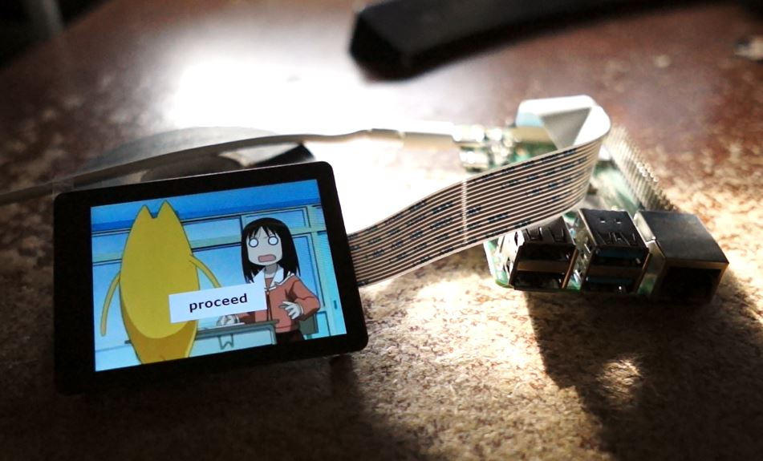

# About

This is intended to be a precursor to the [JDC34](https://github.com/jdc-cunningham/jdc34-camera) and [JDC35](https://github.com/jdc-cunningham/jdc35-camera) cameras that I have developed.

This uses:

- openbox (window manager)
- opencv (gui)
- python (menu logic)

To make a touch screen menu on a Raspberry Pi with a DSI touch screen display.

See the YouTube video going over this code.

# Platform

Note this was tested against Debian 13 Trixie on a Pi 4B with a 2.8" Waveshare DSI touchscreen display. The DSI part is important as the HDMI version handles the touchscreen differently (not natively so more work).

# Code location

Note this code is intended to be placed in the home directory of your raspberry pi eg. `/home/pi` or `~`.

You need to be in the `code` folder to run the commands below.

# Set display dtoverlay

This is important to do as the dislay won't show anything (you'll see a flashing green LED on the back) if this step is not done.

`$sudo nano /boot/firmware/config.txt`

Go to the bottom of the file and add: `dtoverlay=vc4-kms-dsi-waveshare-panel,2_8_inch`

# Run this demo

## Step 1 - install dependencies

The installation commands have been placed in the `install-deps.sh` bash script. Note that it requires sudo to run.

Make it executable: `$chmod +x install-deps.sh` then run with `$./install-deps.sh`

## Step 2 - run openbox

Make the `openbox` file executable with `$chmod +x openbox` and also run `$chmod +x opencv-gui.py`

Then run the menu with `$sudo xinit ./openbox`

You should see your display change and show an image of Osaka from Azumanga Daioh

From there you can click through the basic menu example

# Minimal example

There is another file `opencv-gui-minimal.py` this has the very basic code to show an image on the display without a menu system. To use this file you would edit the `openbox` file and change what's on the right of `--startup`.

# Debugging

If you only see a black screen, tap the screen and you may see a popup window appear saying an error.

Alternatively you can add logging that writes to a file in the `opencv-gui.py` file.
